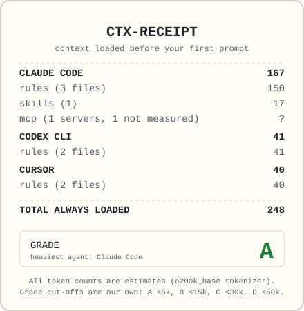

# ctx-receipt

See what your AI coding agent loads into context before you type a word. A token receipt for
your rules files, skills, and MCP servers.

<p align="center"></p>

Coding agents (Claude Code, Codex CLI, Cursor, Gemini CLI) pre-load instruction files, skill
descriptions, and MCP tool definitions before your first prompt. If you use several agents and
several MCP servers, nothing shows you what that costs in one place. `ctx-receipt` scans your
project and your home config, finds what each agent would load, and prints a receipt.

All token counts are **estimates**, made offline with the `o200k_base` tokenizer. Each agent's
own tokenizer gives different numbers. See [How we count](docs/how-we-count.md).

## Quick start

```sh
npx ctx-receipt
```

That scans the current folder and your home config. Common variations:

```sh
npx ctx-receipt path/to/project       # another folder
npx ctx-receipt --no-user             # project files only (what your teammates also get)
npx ctx-receipt --agent claude-code   # one agent
npx ctx-receipt --svg receipt.svg     # also write a shareable card
npx ctx-receipt --mcp                 # start stdio MCP servers and measure their tools
```

Requires Node.js 20 or later. ctx-receipt itself makes no network calls, collects no telemetry,
needs no account, and never changes your files. (With `--mcp` it starts your MCP servers, and
those may use the network.)

## Example

This repository includes a small demo project and a fake home folder in `examples/demo`. From a
clone, after `npm install && npm run build`:

```sh
node dist/cli.js examples/demo/project --home examples/demo/home
```

```
====================================================
                    CTX-RECEIPT
          loaded before your first prompt
====================================================
CLAUDE CODE
  ~/.claude/CLAUDE.md                             17
  skill review                                    17
  CLAUDE.md                                       69
  @docs/architecture.md                           64
  mcp docs (http)                                  ?
                                          ----------
  SUBTOTAL                                       167
  0.1% of a 200k window
  ? = not measured (--mcp measures stdio servers)

CODEX CLI
  ~/.codex/AGENTS.md                              10
  AGENTS.md                                       31
                                          ----------
  SUBTOTAL                                        41
  0.0% of a 200k window

CURSOR
  .cursor/rules/api.mdc (description)              9
  AGENTS.md                                       31
                                          ----------
  SUBTOTAL                                        40
  0.0% of a 200k window

----------------------------------------------------
ON DEMAND (only when used; not in total)
  Claude Code
    skill review                                  21
    skill release                                 48
  Cursor
    .cursor/rules/api.mdc                         24
----------------------------------------------------
TOTAL ALWAYS LOADED                              248
GRADE                                              A
  from the heaviest agent: Claude Code
====================================================
All token counts are ESTIMATES.
Tokenizer: o200k_base via gpt-tokenizer.
Each agent's own tokenizer will differ.
```

Reading it:

- `@docs/architecture.md` is pulled in by an `@` import in `CLAUDE.md`.
- `skill review` appears twice: its one-line listing is always loaded, its body only when used.
- `skill release` has no always-loaded line because it sets `disable-model-invocation: true`.
- The Cursor rule has a description and no `alwaysApply`, so Cursor pre-loads only the
  description and pulls the rule in when relevant.
- `mcp docs` is a remote server, so it is listed but not measured.

## What it counts

|             | Always loaded                                                                      | On demand                           | Unmeasured                          |
| ----------- | ---------------------------------------------------------------------------------- | ----------------------------------- | ----------------------------------- |
| Rules files | CLAUDE.md, AGENTS.md, GEMINI.md and friends, their `@` imports, always-apply rules | Rules scoped to file paths or globs |                                     |
| Skills      | Each skill's listing line (name and description)                                   | The skill body                      |                                     |
| MCP servers | With `--mcp`: what the agent loads up front                                        | With `--mcp`: every tool schema     | Without `--mcp`, and remote servers |

Per agent, it reads:

- **Claude Code:** `CLAUDE.md`, `.claude/CLAUDE.md`, `CLAUDE.local.md` in the project and every
  parent folder, `~/.claude/CLAUDE.md`, `.claude/rules/` and `~/.claude/rules/`, `AGENTS.md` when
  there is no CLAUDE.md, `@` imports (4 hops). Skills in `.claude/skills/` (up to the git root),
  `~/.claude/skills/` including skills synced from claude.ai, and `.claude/commands/`. MCP servers
  from `.mcp.json` and `~/.claude.json` (user and per-project).
- **Codex CLI:** `~/.codex/AGENTS.override.md` or `AGENTS.md`; from the git root down,
  `AGENTS.override.md`, `AGENTS.md`, or your fallback file names, within the 32 KiB budget.
  Skills in `.agents/skills/` and `~/.agents/skills/`. MCP servers from `~/.codex/config.toml` and
  `.codex/config.toml`.
- **Cursor:** `.cursor/rules/**/*.mdc` by apply mode, `AGENTS.md`, `.cursorrules`. MCP servers
  from `.cursor/mcp.json` and `~/.cursor/mcp.json`.
- **Gemini CLI:** `GEMINI.md` (or your `context.fileName`) in `~/.gemini/` and from the project
  up to the git root, with `@` imports. Skills in `.gemini/skills/`, `.agents/skills/`, and the
  same under home. MCP servers from `~/.gemini/settings.json` and `.gemini/settings.json`.

If an agent's config folder (`~/.claude`, `~/.codex`, `~/.cursor`, `~/.gemini`) does not exist,
its home files are skipped and its project files are still counted.

### Not counted

- Each agent's own system prompt and built-in tools.
- Claude Code: managed policy files, auto memory (`MEMORY.md`), CLAUDE.md files and skills in
  subfolders (they load on demand), plugin and bundled skills, plugin and claude.ai MCP servers.
- Codex: `CODEX_HOME`, admin and bundled skills, profiles, whether the project is trusted.
- Cursor: User Rules and Team Rules (stored in Cursor, not in files), servers turned off in the app.
- Gemini CLI: system settings, extensions, built-in skills, `context.includeDirectories`.

## MCP servers and `--mcp`

Measuring an MCP server means starting it, which runs a command from your config. So
ctx-receipt does that only when you pass `--mcp`:

- It starts stdio servers only. Remote servers stay unmeasured.
- Before starting anything, it prints each server's agent, name, transport, and config file. It
  never prints the command, its arguments, or its environment.
- The server's own error output is discarded.
- Each server has 10 seconds to list its tools, and is shut down afterwards (or when the time
  runs out).
- `--mcp <name>` starts only the server with that name.

Each measured server shows two numbers: what the agent loads **up front** (counted in the total),
and the cost of **all schemas, if loaded**. Claude Code defers MCP tool schemas by default
(tool search), so its up-front number is usually much smaller. See
[How we count](docs/how-we-count.md#mcp-servers).

MCP configs often hold API keys. ctx-receipt reads only the server name and transport from them
for the report; the launcher reads the command and environment only to start the server. Tests
check that a fake key planted in every field of every config format never reaches any output.

## Options

| Option              | What it does                                                         |
| ------------------- | -------------------------------------------------------------------- |
| `[path]`            | Project to scan. Default: the current folder                         |
| `--agent <name...>` | Only these agents: `claude-code`, `codex`, `cursor`, `gemini`        |
| `--no-user`         | Skip home-directory config                                           |
| `--home <dir>`      | Use another folder as home                                           |
| `--mcp [name]`      | Start stdio MCP servers (or only `name`) and measure their tools     |
| `--json`            | Print a JSON report to stdout instead of the receipt                 |
| `--md <file>`       | Also write a Markdown report                                         |
| `--svg <file>`      | Also write a shareable SVG card. It shows totals only, no file names |
| `--budget <tokens>` | Exit 1 if the total always loaded is over `tokens`                   |

Exit codes: `0` ok, `1` over budget, `2` usage error, `3` scan error (for example, a config file
that is not valid JSON or TOML).

## Use in CI

Keep your project's pre-loaded context in check on every pull request:

```yaml
# .github/workflows/context-budget.yml
name: Context budget
on: [pull_request]
jobs:
  ctx-receipt:
    runs-on: ubuntu-latest
    steps:
      - uses: actions/checkout@v4
      - uses: actions/setup-node@v4
        with:
          node-version: 22
      - run: npx ctx-receipt --no-user --budget 8000
```

`--no-user` keeps the check to what is in the repository. The step fails when the total always
loaded is over the budget. Add `--json > ctx-receipt.json` to keep a machine-readable report.

## Supported agents

Each adapter was written from the agent's official documentation, checked on 2026-11-12.

| Agent       | Rules                                                          | Skills                  | MCP config | MCP up-front cost                   |
| ----------- | -------------------------------------------------------------- | ----------------------- | ---------- | ----------------------------------- |
| Claude Code | verified                                                       | verified                | verified   | verified (deferred by default)      |
| Codex CLI   | verified                                                       | verified                | verified   | **unverified**: assumed all schemas |
| Cursor      | verified; `.cursorrules` **unverified** (no longer documented) | not supported by Cursor | verified   | **unverified**: assumed all schemas |
| Gemini CLI  | verified                                                       | verified                | verified   | all schemas; no deferral documented |

Where the docs disagree or say nothing, we take the reading that counts more, and say so in
the adapter's source and in [How we count](docs/how-we-count.md).

## Limitations

- Numbers are estimates from one tokenizer, not each agent's. They do not include the agent's
  own system prompt or the wrapping it adds around your files.
- The context window is assumed to be 200k tokens for percentages and listing caps.
- Skill listing caps: when an agent trims descriptions to fit, we cannot know which ones it
  trims, so per-skill numbers under a cap are approximate (the total is right).
- Settings that live inside an app rather than in files (Cursor User Rules, toggles in `/mcp`)
  are invisible to us.
- Behaviour follows each agent's docs at the date above. Agents change fast; if something looks
  wrong, please [open an issue](CONTRIBUTING.md).

## Contributing

Bug reports and new agents are welcome. See [CONTRIBUTING.md](CONTRIBUTING.md) and
[Adding an agent](docs/adding-an-agent.md).

## License

[MIT](LICENSE)
